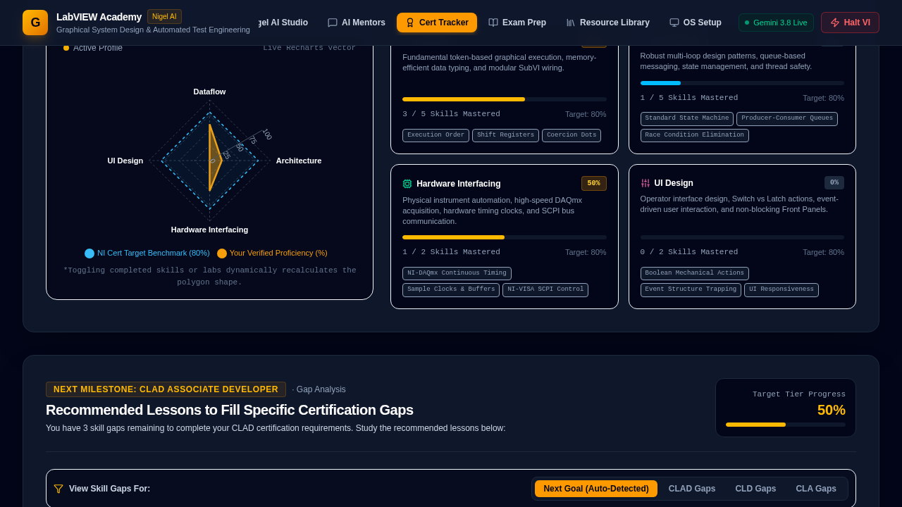

# LabVIEW Academy & Nigel AI Mentor

A free, interactive learning app for LabVIEW, automated test engineering and Nigel AI prompting:
a curriculum, a dataflow simulator with hands-on labs, CLAD/CLD/CLA exam prep, a certification
readiness tracker, a resource library, and AI-style mentors and a prompt studio.

**100% free and offline-capable.** There is no backend, no API key, no account, no credits and no
usage limits. Everything runs in your browser, including the mentors and the prompt studio, which
are powered by a built-in, deterministic knowledge base instead of a paid AI service. Fonts are
self-hosted, so the built app makes no third-party requests.



## Quick start

Requires Node.js **22.18+** (see `.nvmrc`).

```bash
npm install
npm run dev        # http://localhost:5173
```

## Scripts

| Command | What it does |
| --- | --- |
| `npm run dev` | Vite dev server with HMR |
| `npm run build` | Production build into `dist/` |
| `npm start` / `npm run preview` | Serve the built `dist/` locally |
| `npm run lint` | Type-check (`tsc --noEmit`, strict) |
| `npm test` | Unit tests (Node's built-in runner) |
| `npm run check` | lint, test and build, the same as CI |

## Hosting

The output of `npm run build` is a plain static site (`dist/`). Host it for free anywhere that
serves static files: GitHub Pages, Netlify, Cloudflare Pages, Vercel, or any web server. There
is nothing to configure and nothing that can run out of quota.

## How the "AI" works

- **Mentor chat** (`src/utils/mentor-engine.ts`, `src/data/mentorKnowledge.ts`): questions are
  matched against a curated knowledge base of LabVIEW topics (dataflow, race conditions, state
  machines, VISA/SCPI, DAQmx, error handling, and more). Each of the three mentors frames the
  answer from their own specialty. Unmatched questions get a helpful fallback with suggested
  questions. To teach it something new, add a topic to `mentorKnowledge.ts`; a test keeps
  entries consistent.
- **Nigel Prompt Studio** (`src/utils/nigel-blueprint.ts`): scores a prompt with the same rubric
  as the live evaluator and generates an optimized prompt, state list, key nodes and pitfalls for
  the chosen architecture and hardware.
- Output is deterministic, so it is fully unit-tested.

## Project layout

```
src/
  App.tsx            shell, persisted progress state, lazy-loaded views
  components/        one view per tab, plus ErrorBoundary and RichText (safe Markdown subset)
  data/              static curriculum, labs, exam, resource and mentor knowledge content
  utils/             pure logic (simulator engine, tracker, evaluators, mentor engine, storage), tested
  types/             shared types
```

Progress (milestones, labs, skills, exam answers) is saved to `localStorage` and tolerates
corrupt or blocked storage. Views are code-split with `React.lazy`, and a per-view error
boundary keeps one crash from blanking the app.

## Screenshots

See [docs/screenshots](docs/screenshots).
